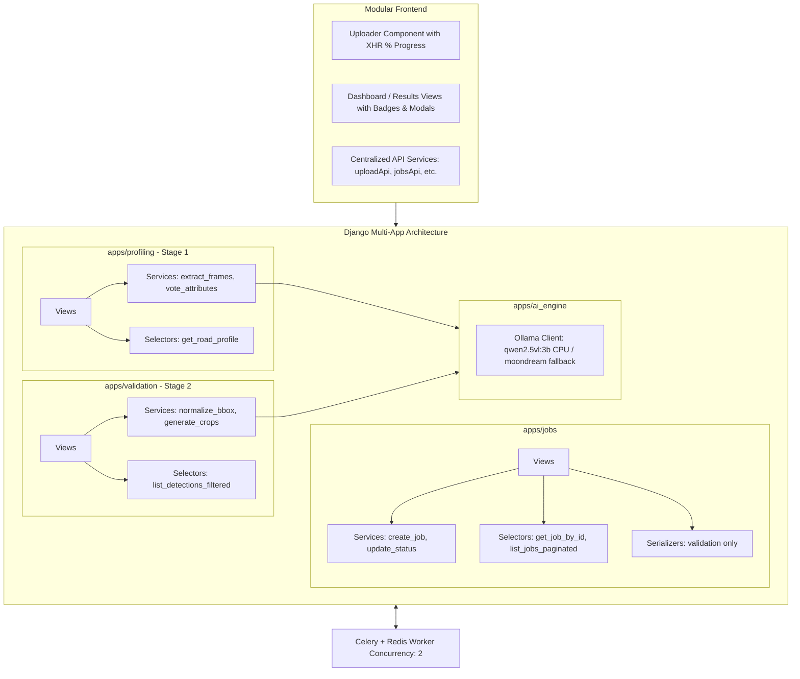

# RoadAthena AI: Technical Implementation Plan

## Goal Description
RoadAthena AI is a two-stage computer vision & vision-language model (VLM) pipeline:
1. **Stage 1 (AI Road Profiling):** Analyzes inspection video to identify road attributes (Road Type, Pavement Type, Carriageway Type, Lanes, Width) and maps them to a detection model configuration.
2. **Stage 2 (AI Detection Validator):** Verifies defect detection boxes (potholes, cracks, rutting, etc.) against visual evidence, returning verdicts (**Correct**, **Incorrect/False**, or **Needs Review**) with detailed reasoning.
3. **Enterprise-Grade Fullstack Architecture:** Modular Django REST Framework backend partitioned into decoupled apps with strict layered flow (**models, serializers, selectors, services, views, urls**), universal pagination/search/sort, real-time file upload percentage tracking, and a clean, separated frontend.
4. **Hardware-Tailored AI Engine:** Configured specifically for the host machine (**Intel i5-8500 6-core CPU, 16GB RAM, CPU-only**), leveraging quantized **`qwen2.5vl:3b`** (with **`moondream:latest`** ultra-light fallback), 768px downscaling, and capped concurrency.



---

## Hardware Profile & AI Model Policy

> [!IMPORTANT]
> **Host Hardware Detected:**
> - **CPU**: Intel(R) Core(TM) i5-8500 CPU @ 3.00GHz (6 physical cores)
> - **RAM**: 16 GB Total (~3.5–4.5 GB free memory available)
> - **GPU**: **None (CPU-Only environment, no NVIDIA CUDA)**
> - **Local VLM Standard**:
>   - **Primary Model**: **`qwen2.5vl:3b`** via Ollama (Quantized Q4_K_M, ~2.2 GB RAM usage, runs reliably on 6 CPU cores).
>   - **Fast Alternative / Fallback**: **`moondream:latest`** (1.7B VLM, ~1.2 GB RAM, sub-3 second per-frame CPU inference).
> - **CPU Optimization Safeguards**:
>   - Images & video frames downscaled to max width 768px before VLM ingestion.
>   - Stage 1 extracts 8 key sharp frames (filtered with Laplacian variance blur detector).
>   - Celery worker concurrency locked to `2` to prevent CPU core contention and OOM.

---

## Architectural Rules & Standards

### 1. Backend Layering & Structure
The backend is organized into 4 distinct domain apps under `apps/`:
- `apps/jobs`: Job state machine, file upload sessions, upload percentage tracking.
- `apps/profiling`: Stage 1 video ingestion, frame extraction, consensus voting, model configuration matrix.
- `apps/validation`: Stage 2 detection ingestion, bounding box normalizer, crop extractor, validation verdicts.
- `apps/ai_engine`: Reusable Ollama client, structured JSON parser, prompt builders, fallback handler.

**Strict separation of concerns within each app:**
| File | Responsibility | Rule |
|---|---|---|
| `models.py` | Schema, fields, foreign keys, indexes | No heavy business logic or external calls |
| `serializers.py` | Input validation & output serialization | **Validation only**. No DB creates/updates |
| `services.py` | Business logic & database mutations | All writes, Celery triggers, and OpenCV calls |
| `selectors.py` | Read queries & data extraction | **QuerySets only**. Strictly zero writes |
| `views.py` | HTTP controller | Validate with serializer ➔ Call service/selector ➔ Return Response |
| `urls.py` | Routing definitions | RESTful endpoints |

### 2. API Standards
- **Universal Pagination**: Custom `StandardResultsSetPagination` on all list endpoints returning:
  `{ "count": 100, "total_pages": 10, "current_page": 1, "page_size": 10, "results": [...] }`
- **Searching & Sorting**: DRF `DjangoFilterBackend`, `SearchFilter`, and `OrderingFilter` applied on all list endpoints (e.g., search by class name, sort by confidence or creation date).
- **Upload Percentage Tracking**:
  - Endpoint `POST /api/jobs/upload/` handles chunked or tracked file uploads.
  - Client-side XHR `upload.onprogress` calculates real-time `0% - 100%` upload percentage.
  - An `UploadSession` tracker records byte streams and notifies the frontend before triggering the background worker.

### 3. Frontend Separation
- Clean folder division:
  - `templates/`: Semantic layout, page templates, and modal components.
  - `static/js/api/`: Centralized API clients (`jobsApi.js`, `profilingApi.js`, `validationApi.js`, `uploadApi.js`).
  - `static/js/components/`: Modular widgets (`UploadProgressWidget.js`, `VerdictBadge.js`, `KeyframeCarousel.js`, `BboxZoomModal.js`).
  - `static/css/`: Curated design tokens, glassmorphism dark theme, zero CSS clutter.

---

## Proposed Changes

### [Component 1] Core App Structure & Base Config

#### [NEW] `core/settings.py`, `core/celery.py`, `core/urls.py`
Configure Django 5.x, DRF, Celery with Redis broker, static & media root settings.

#### [NEW] `apps/core/pagination.py`
```python
from rest_framework.pagination import PageNumberPagination
from rest_framework.response import Response

class StandardResultsPagination(PageNumberPagination):
    page_size = 10
    page_size_query_param = 'page_size'
    max_page_size = 100

    def get_paginated_response(self, data):
        return Response({
            'count': self.page.paginator.count,
            'total_pages': self.page.paginator.num_pages,
            'current_page': self.page.number,
            'page_size': self.get_page_size(self.request),
            'results': data
        })
```

---

### [Component 2] App: `apps/ai_engine`

#### [NEW] `apps/ai_engine/vlm_client.py`
Ollama interface tuned for CPU execution (`qwen2.5vl:3b` with fallback to `moondream:latest`).
Includes image resizing to 768px, single retry, and JSON schema enforcing.

#### [NEW] `apps/ai_engine/prompts.py`
- Road Profiling Prompt (Road type, pavement type, carriageway, lanes, estimated width).
- Detection Validator Prompt (Defect definitions, look-alike disqualifiers: shadows, seams, manholes, leaves, wet asphalt).

---

### [Component 3] App: `apps/jobs`

#### [NEW] `apps/jobs/models.py`
`Job` model with status (`queued`, `uploading`, `running`, `done`, `failed`), stage (`stage1`, `stage2`), upload session stats, error logs.

#### [NEW] `apps/jobs/serializers.py`
`JobCreateSerializer`, `JobDetailSerializer` (Strict validation only).

#### [NEW] `apps/jobs/services.py`
`create_job_service()`, `update_job_status_service()`, `mark_job_failed_service()`.

#### [NEW] `apps/jobs/selectors.py`
`get_job_by_id()`, `list_jobs_filtered(stage, status, search, ordering)`.

#### [NEW] `apps/jobs/views.py` & `apps/jobs/urls.py`
- `POST /api/jobs/upload/`: Ingests files with byte-level progress acknowledgment.
- `GET /api/jobs/`: Paginated, searchable, sortable list of jobs.
- `GET /api/jobs/{id}/status/`: Real-time status polling endpoint.

---

### [Component 4] App: `apps/profiling` (Stage 1)

#### [NEW] `apps/profiling/models.py`
`RoadProfile` model storing 5 road attributes, confidence scores JSON, extracted keyframes paths, and selected model configuration string.

#### [NEW] `apps/profiling/services.py`
- `extract_sharp_frames(video_path, max_frames=8)`: OpenCV extractor with Laplacian variance threshold.
- `profile_video_pipeline(job_id)`: Orchestrates per-frame VLM calls, majority voting, width sanity check, config matrix selection.

#### [NEW] `apps/profiling/selectors.py`
`get_road_profile_for_job(job_id)`.

#### [NEW] `apps/profiling/views.py` & `apps/profiling/urls.py`
- `POST /api/profiling/run/`: Start Stage 1 profiling for a job.
- `GET /api/profiling/{job_id}/`: Retrieve full profile with confidence details.

---

### [Component 5] App: `apps/validation` (Stage 2)

#### [NEW] `apps/validation/models.py`
`DetectionRecord` model storing image name, class, original confidence, bbox JSON, verdict (`Correct`, `Incorrect/False`, `Needs Review`), reason, crop image path, annotated overlay image path.

#### [NEW] `apps/validation/services.py`
- `normalize_bbox(raw_bbox, img_w, img_h)`: Normalizes format (`xyxy`, `xywh`, normalized `0-1`) and clamps to boundaries.
- `generate_crop_and_overlay(image_path, bbox)`: Generates 15% padded crop and visual box overlay.
- `validate_detections_pipeline(job_id)`: Runs VLM validation across detections and generates validated JSON.

#### [NEW] `apps/validation/selectors.py`
`list_detections_for_job(job_id, status_filter, class_search, ordering)` with pagination.

#### [NEW] `apps/validation/views.py` & `apps/validation/urls.py`
- `POST /api/validation/run/`: Ingests detection JSON and triggers validation.
- `GET /api/validation/{job_id}/detections/`: Paginated, filterable table data.
- `GET /api/validation/{job_id}/export/`: Downloads validated JSON file.

---

### [Component 6] Frontend Architecture & Modular UI

#### Design System & CSS Token Specifications
- **Design Philosophy**: Minimalist, high-utility developer aesthetic (dark slate `#0f172a`, card surface `#1e293b`, 1px border `#334155`, Inter typography).
- Semantic accent tokens:
  - `--color-correct`: `#10b981` (Emerald)
  - `--color-incorrect`: `#ef4444` (Rose / Red)
  - `--color-review`: `#f59e0b` (Amber)
  - `--color-primary`: `#6366f1` (Indigo CTA)
  - `--color-bg`: `#090d16`
  - `--color-surface`: `#111827`
  - `--color-border`: `#1f2937`
  - `--color-text`: `#f9fafb`
  - `--color-text-muted`: `#9ca3af`

#### [NEW] `templates/` Architecture
- `templates/layouts/base.html`: Minimalist header, navigation pills, flash toast container, and global modal portal.
- `templates/components/`:
  - `_metric_card.html`: Reusable metric card with label, value, confidence meter, and tooltip.
  - `_stepper.html`: Multi-stage pipeline progress stepper (`Upload` ➔ `Extract` ➔ `Inference` ➔ `Aggregate`).
  - `_status_badge.html`: Semantic color-coded pill.
  - `_table_controls.html`: Search bar, filter pills, page-size dropdown, export button.
- `templates/pages/`:
  - `index.html`: Clean system overview, quick status cards, recent inspection jobs table.
  - `stage1.html`: Road profiling workbench (video dropzone, live upload %, keyframe carousel, 5 profile cards, model matrix badge).
  - `stage2.html`: Detection validator workbench (JSON/Image uploader, detection verification data table, crop zoom modal, JSON download).

#### [NEW] `static/js/api/` (Decoupled Client Layer)
- `client.js`: Generic HTTP client with CSRF token injection and error handling.
- `uploadApi.js`: XHR-based file upload with byte-level `onprogress` callback returning `(percent, bytesUploaded, totalBytes)`.
- `jobsApi.js`: Polling service for asynchronous task status updates.
- `profilingApi.js`: Fetch and trigger road profiling endpoints.
- `validationApi.js`: Fetch, filter, and export detection validation results.

#### [NEW] `static/js/components/` (Reusable UI Modules)
- `FileUploadZone.js`: Drag-and-drop file target with file size/type validation, cancel button, and upload percentage visualization.
- `ProgressBar.js`: Reusable progress indicator supporting both continuous percentage bars and segmented steppers.
- `StatusBadge.js`: Renders badges for verdicts (`Correct`, `Incorrect/False`, `Needs Review`) and states (`Queued`, `Running`, `Done`, `Failed`).
- `DataTable.js`: Modular data table with client-side or server-side pagination, sorting, search filter, and custom row renderers.
- `ImageZoomModal.js`: Accessible modal with smooth zoom, pan, bounding-box overlay toggle, and keyboard shortcuts (`Esc` to close).
- `Toast.js`: Non-intrusive floating toast notifications for user alerts and network error notices.

#### Extensibility & Future Improvements
1. **Zero-Lockin API Foundation**: Every page uses strictly decoupled ES6 API modules (`uploadApi.js`, `jobsApi.js`), allowing instant migration to a React/Vue/Next.js SPA in the future without changing a single backend line.
2. **Dynamic Filter Schemas**: `DataTable.js` accepts dynamic filter definitions, allowing new attributes (e.g. defect severity, confidence ranges, road weather) to be added with a single schema configuration.
3. **Theming & Token Overrides**: All styling originates in `tokens.css`, making light/dark toggle or enterprise re-theming instantaneous.

---

### [Component 7] Centralized Environment Configuration (`.env` & `.env.example`)

All runtime settings and tunable parameters are decoupled into `.env`:
```ini
# --- Django Core & Security ---
DEBUG=True
SECRET_KEY=roadathena-insecure-secret-key-change-in-production
ALLOWED_HOSTS=*

# --- Database ---
# Docker defaults to Postgres; local defaults to SQLite if left empty
DATABASE_URL=sqlite:///db.sqlite3
# In Docker: DATABASE_URL=postgres://postgres:postgres@db:5432/roadathena

# --- Celery & Redis Task Broker ---
REDIS_URL=redis://localhost:6379/0
CELERY_BROKER_URL=redis://localhost:6379/0
CELERY_RESULT_BACKEND=redis://localhost:6379/0
CELERY_WORKER_CONCURRENCY=2

# --- AI & VLM Engine ---
# AI_PROVIDER: 'gemini' (ultra-fast for dev/benchmarking) or 'ollama' (required for official submission)
AI_PROVIDER=gemini
GEMINI_API_KEY=
GEMINI_MODEL=gemini-flash-latest

OLLAMA_BASE_URL=http://localhost:11434
# In Docker: OLLAMA_BASE_URL=http://ollama:11434
VLM_MODEL=qwen2.5vl:3b
VLM_FALLBACK_MODEL=moondream:latest
VLM_TIMEOUT_SECONDS=45
VLM_MAX_IMAGE_WIDTH=768
VLM_TEMPERATURE=0.1

# --- Stage 1 & Stage 2 Pipeline Hyperparameters ---
STAGE1_SAMPLE_FRAMES=8
STAGE1_LAPLACIAN_BLUR_THRESHOLD=100.0
STAGE2_BBOX_PADDING_RATIO=0.15
STAGE2_CONCURRENT_DETECTIONS=2
MAX_UPLOAD_SIZE_MB=500
```

---

## Verification Plan

### Automated Tests
1. **App Architecture & Flow Verification:**
   - Test serializers reject invalid formats without calling DB.
   - Test selectors strictly return QuerySets without performing writes.
   - Test services execute atomic DB updates.
2. **Pagination & Filter Tests:**
   ```bash
   pytest tests/test_pagination_and_filters.py
   ```
   Ensures page, page_size, search, and ordering queries work across all CRUD endpoints.
3. **Upload Progress & File Handler Tests:**
   ```bash
   pytest tests/test_upload_tracking.py
   ```
4. **VLM CPU Performance Test:**
   ```bash
   python manage.py test_vlm_cpu --model=qwen2.5vl:3b
   ```
   Validates inference timing and memory usage on the 6-core Intel i5 CPU.

### Manual Verification
1. Test video upload with visible 0% ➔ 100% upload progress bar before background processing starts.
2. Inspect Stage 1 road profile results, confidence meters, and keyframes.
3. Inspect Stage 2 detection validation table: test sorting by confidence, filtering by "Incorrect/False", previewing crop zoom modals, and downloading validated JSON.
